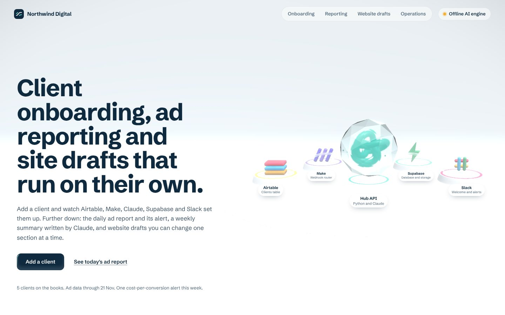
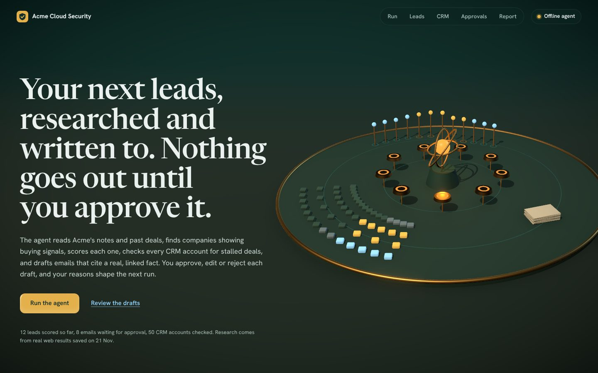

# AI automation demos

Two working demos, each running end to end on fake or public data:

| Demo | What it proves | Folder |
|---|---|---|
| **Northwind Digital: Agency Automation Hub** | Make.com and Airtable triggers, a Python service, Supabase, Claude-written briefs and summaries, a reporting pipeline with alerts, a 3D dashboard | [demo-1-automation-hub](demo-1-automation-hub) |
| **Acme Cloud Security: B2B Sales Agent** | An autonomous agent loop with tools, web research with cited sources, explainable lead scoring, CRM analysis, drafted outreach held for human approval, learning from feedback | [demo-2-sales-agent](demo-2-sales-agent) |

## Shared rules, and where each is enforced

- **Fake or public data only.** Demo 1's clients and Demo 2's CRM are invented. Demo 1's ad numbers are priced from published industry benchmarks, and Demo 2's leads come from public web pages, each with its link.
- **Secrets live in environment variables.** Each demo has a `backend/.env.example`; nothing secret is committed.
- **Every automation logs success and failure**, and failures alert Slack (`automation_log` in Demo 1, `agent_runs` and `activity_log` in Demo 2).
- **Nothing reaches a customer without approval.** Demo 2 has no send tool; an email file exists only after a recorded approval. Tests check this.

## Deploy

1. Fork or clone this repository.
2. In [Render](https://render.com): New, then Blueprint, then pick the repository. `render.yaml` creates both services on the free plan.
3. Fill in any keys Render asks for. Each one is optional: without it, that part runs offline and the page says so.
4. Set `SITE_URL` to each service's address and redeploy, so canonical links, the sitemap and social cards point at it.
5. For Demo 1's daily job, add the repository secrets `HUB_URL` and `HUB_API_TOKEN`.

Free instances sleep when idle, so the first visit can take about a minute. Without `DATABASE_URL` each service uses SQLite and starts fresh after a restart; with a Supabase connection string, everything persists.

## Answers to the spec's open questions

- **Web search API for Demo 2:** Tavily. It is built for agents, returns clean text with each result's URL, and its free plan gives 1,000 credits a month (one per basic search). Without a key, the agent uses a saved set of real results so the demo always works.
- **Lovable or Replit for the front ends:** neither. Both front ends are hand-built React with React Three Fiber, served by the same FastAPI service as the API, so each demo is a single deploy with no second platform to keep in sync.
- **Make.com blueprints:** in the repo as importable JSON, `demo-1-automation-hub/backend/make/`, with a script that fills in your API address and token before import.

## Checks

`.github/workflows/ci.yml` runs both demos' backend tests and type-checks and builds both front ends on every push.

See [THIRD_PARTY_NOTICES.md](THIRD_PARTY_NOTICES.md) for the open-source pieces used.
