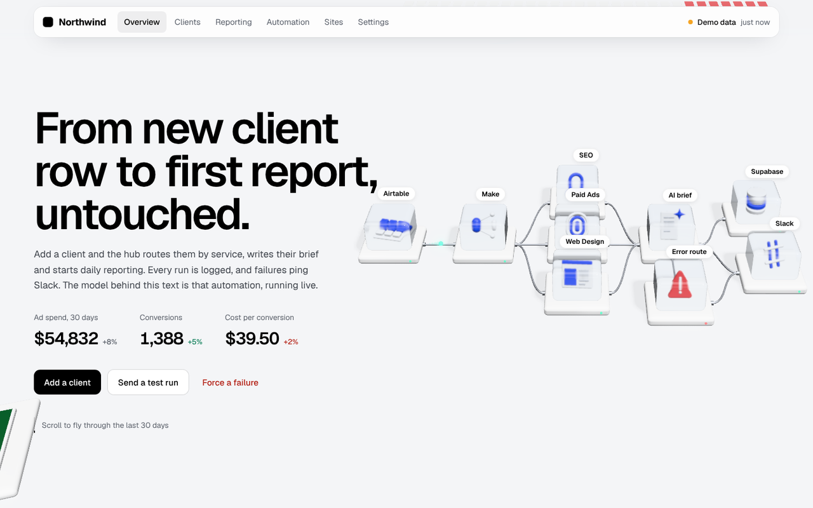
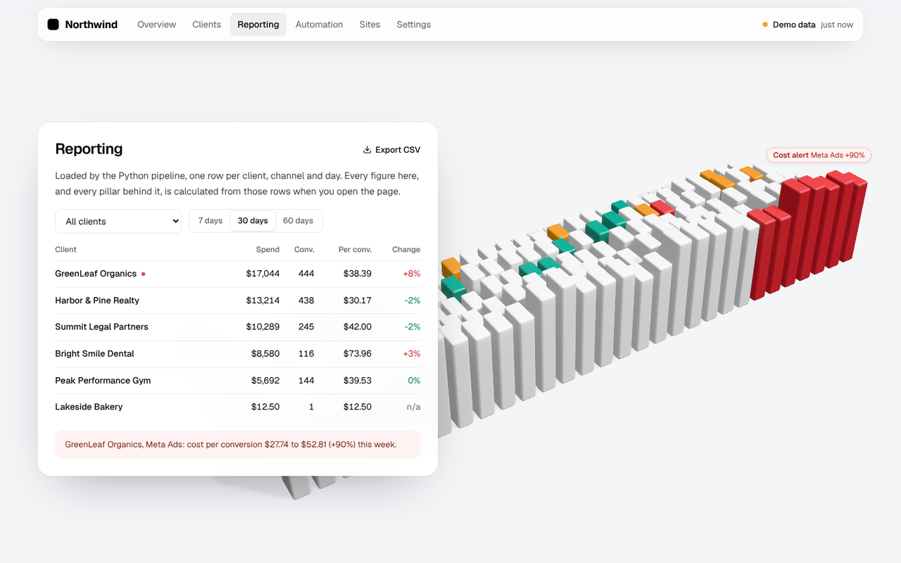
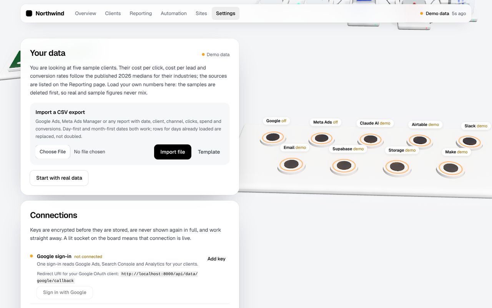
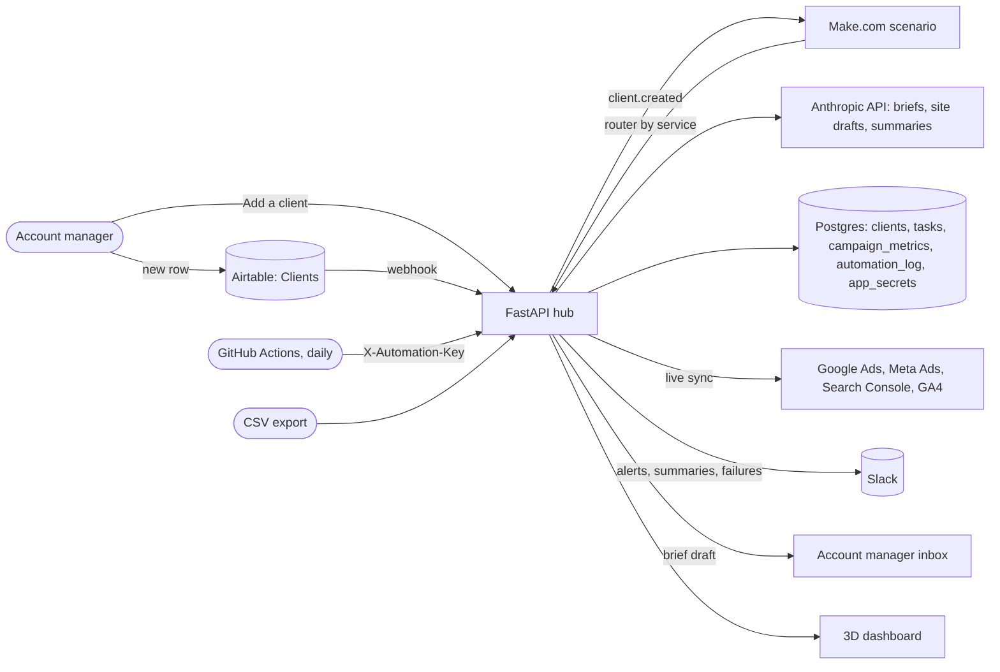

# Demo 1: Northwind Automation Hub

Client onboarding and ad reporting for a small digital agency, **Northwind Digital** (fictional).
An account manager adds a client once. The hub routes them by service, writes their brief, sets
up their checklist and starts daily reporting across Google Ads, Meta Ads and SEO. Every run is
logged, and every failure is posted to Slack.

**Live:** https://automation-hub-production-0b8f47e0.up.railway.app  
A one-page summary for clients is in [docs/one-pager.md](docs/one-pager.md).

## What it does

| Workflow | Trigger | What happens |
| --- | --- | --- |
| Onboarding | A new row in Airtable, or **Add a client** in the hub | Make.com (or the built-in orchestrator when Make is not connected) routes the client by service: SEO, Paid Ads, Web Design. Each service gets its checklist and a Slack welcome. |
| AI brief | Part of onboarding | Claude writes a one-page brief from the client's website and services. It is saved to Airtable and emailed to the account manager as a draft. |
| Website draft | Web Design clients | A first-draft site, sanitised and stored in Supabase Storage. Any single section can be rewritten without touching the rest. |
| Daily reporting | Every morning (GitHub Actions) or **Sync now** | Pulls spend, clicks and conversions per client and channel, re-reads recent days (platforms restate conversions) and upserts, so running it twice never duplicates a row. |
| Cost alerts | After each sync | A campaign is flagged when its cost per conversion rises more than 25% week on week **and** a Poisson test says the drop in conversions is real (p < 0.05). Small-number noise is ignored. |
| Weekly summary | **Weekly summary** button | Three plain sentences per client, written from the live numbers. |
| Off-boarding | Status set to **Churned** | Open tasks closed, client archived, summary posted to Slack. |
| Error route | Any failure | Written to `automation_log` with the step that failed, and posted to Slack. **Force a failure** on the home page proves it. |

## Demo data, live data, your data

The hub starts with **demo data** and switches to real numbers from the Settings page.

* **Demo data** is not random. Each client's click-through rate, cost per click and cost per lead
  sit on the published 2026 median for its industry, with a fixed offset of up to 12% per client:
  [WordStream Google Ads Benchmarks 2026](https://www.wordstream.com/blog/2026-google-ads-benchmarks),
  [LocaliQ Facebook Advertising Benchmarks 2026](https://localiq.com/blog/facebook-advertising-benchmarks/),
  [Ahrefs organic CTR](https://ahrefs.com/blog/what-is-a-good-ctr/) (1.5%) and
  [Ruler Analytics conversion rate by industry](https://ruleranalytics.com/blog/insight/conversion-rate-by-industry/).
  `GET /api/data/benchmarks` lists every figure and its source. One event is scripted on
  purpose: GreenLeaf Organics' Meta cost per lead roughly doubles in the last 7 days, so the
  alert has something real to catch.
* **Live data** comes straight from the ad platforms. One **Sign in with Google** reads Google
  Ads, Search Console and Google Analytics 4 (organic conversions only). A Meta system user token
  reads Meta Ads insights. The hub syncs every hour (`LIVE_SYNC_MINUTES`). A newly linked client
  gets 60 days at once, so its 30-day totals and their comparison are complete. After that the
  first sync of the day re-reads 14 days and the rest the last 3, because platforms restate
  conversions. An account that reports in another currency than `REPORT_CURRENCY` is left out
  with a warning instead of being added to the totals.
* **Your data** is a CSV export from any platform: `date, client, channel, impressions, clicks,
  spend, conversions`. Common header names from Google Ads, Meta and Looker Studio exports are
  recognised, day-first dates are detected, and future dates are refused.

Once real data is loaded the whole app locks behind an access code (`OWNER_TOKEN`, plus an
optional read-only `VIEWER_TOKEN` for teammates), because client numbers are private.

## Architecture

* **Backend** (`backend/`): FastAPI and SQLAlchemy Core. SQLite locally, Postgres in production
  (Railway, Supabase or any Postgres). The pipeline lives in `app/workflows/metrics_pipeline.py`,
  the platform connectors in `app/services/connectors.py`.
* **Make.com** (`make/`): two scenario blueprints, onboarding and off-boarding, each with an error
  route. They fit the Make Free plan. See [make/README.md](make/README.md).
* **Airtable** (`airtable/`): the Clients table and three ways to trigger the flow, including a
  webhook bridge that works on the Free plan. See [airtable/README.md](airtable/README.md).
* **Frontend** (`frontend/`): React 19, Vite, Tailwind and React Three Fiber. One 3D scene sits
  behind every page and the camera flies to the part of the system each section talks about.
  Each route is served with its own title, description and JSON-LD for search engines.
* **Keys pasted in Settings** are encrypted with Fernet (key derived from `APP_SECRET`) before
  they reach the database, shown masked, and can only be changed with the owner access code.
  A saved key overrides the environment variable; **Remove saved keys** falls back to it.

## Run it locally (about 5 minutes)

1. `git clone https://github.com/umer-78/ai-automation-demos && cd ai-automation-demos/demo-1-automation-hub`
2. `python3.11 -m venv .venv && source .venv/bin/activate && pip install -r backend/requirements-dev.txt`
3. `cd frontend && npm ci && npm run build && cd ..` (builds the dashboard into `backend/app/static`)
4. `cp .env.example .env` (every key is optional; with none, the hub runs offline with template AI output and a simulated Slack feed)
5. `cd backend && uvicorn app.main:app --reload`, open http://localhost:8000
6. `python -m pytest -q` runs the 73 tests

For dashboard development run `npm run dev` in `frontend/` (port 5173, proxies `/api`).

## Deploy (Railway, about 10 minutes)

1. New project, **Deploy from GitHub repo**, pick this repo. Set the service's root directory
   to `demo-1-automation-hub`; Railway finds the Dockerfile.
2. Add a **Postgres** database to the project and set `DATABASE_URL=${{Postgres.DATABASE_URL}}`
   on the service.
3. Set `ENVIRONMENT=production`, `PUBLIC_BASE_URL` (the service URL), and long random values for
   `OWNER_TOKEN`, `APP_SECRET`, `AUTOMATION_API_KEY` and `ADMIN_TOKEN`.
4. Generate a domain. Open **Settings** in the app, enter the owner code and paste any keys
   (Anthropic, Slack, Airtable, Make, Google, Meta). Each one has a **Test connection** button.
5. Optional: add repository secrets `NORTHWIND_URL` and `NORTHWIND_AUTOMATION_KEY` so
   `.github/workflows/northwind-daily.yml` runs the pipeline every morning.

`render.yaml` at the repo root does the same on Render (free plan, Supabase for the database).

## Connect real accounts

1. **Google**: in Google Cloud, create an OAuth client (type *Web application*) and add the
   redirect URI the Settings page shows. Paste the client ID and secret, then **Sign in with
   Google** with an account that can see the clients' Google Ads, Search Console and Analytics.
   Google Ads also needs a developer token (Basic access) and, for a manager account, its ID.
2. **Meta**: in Business Settings, create a system user with `ads_read` on the ad accounts and
   paste its token.
3. **Start with real data** clears the demo. Under **Client accounts**, add each client and use
   **Find my accounts** to pick their Google Ads customer ID, Meta ad account, Search Console
   property and Analytics property. The SEO fee per month is spread across the days.
4. **Sync now** pulls 60 days for each new client. After that the hub syncs on its own every hour.

**Show the demo again** deletes the real data and reloads the sample.

## Acceptance criteria

| Criterion | How it is met | Test |
| --- | --- | --- |
| Adding a client runs onboarding with no manual steps | Router by service, checklist, brief, Slack welcome, all logged | `test_adding_a_client_runs_full_onboarding_without_manual_steps`, `test_onboarding_blueprint_runs_end_to_end` |
| Running the daily job twice creates no duplicates | Upserts on client, channel and date | `test_rerunning_the_daily_job_twice_creates_no_duplicates` |
| The dashboard reads live data, not hardcoded numbers | Every figure comes from the API | `test_dashboard_reads_live_data_not_hardcoded_numbers` |
| Only real cost spikes raise an alert | 25% threshold plus a Poisson test | `test_cpa_alert_badge_flags_only_the_spiking_campaign`, `test_poisson_guard_ignores_noise_and_catches_real_drops` |
| Failures are logged and alerted | `automation_log` and Slack, Make error route | `test_forced_failure_shows_in_automation_log_and_slack`, `test_make_deliberate_failure_and_error_route` |
| Live numbers match what the platforms report | Connectors tested against mock responses in each platform's documented format | `test_live_sync_stores_exactly_what_the_platforms_report` |
| A new client gets complete 30-day totals | 60-day backfill on its first sync | `test_first_sync_backfills_so_30_day_totals_are_complete` |
| Imported totals match the file | Header aliases, date order detection | `test_csv_import_replaces_demo_and_totals_match_the_file` |
| Real data is never public | Access code on every route once real data is in | `test_real_data_needs_an_access_code`, `test_owner_token_guards_writes` |

The suite also runs on Postgres (`TEST_DATABASE_URL=postgresql://... pytest`), which is what CI does.

## API

Interactive docs at `/docs`. Main routes: `POST /api/clients`, `POST /api/clients/{id}/churn`,
`GET /api/metrics/overview|trend|channels|alerts|insights`, `GET /api/metrics/export.csv`,
`GET /api/data/status`, `POST /api/data/import`, `POST /api/data/sync`, `GET|PUT /api/data/accounts`,
`GET /api/data/benchmarks`, `GET|PUT|DELETE /api/settings/{provider}`, `GET /api/automation/logs`.
Make.com calls `/api/automation/*` with the `X-Automation-Key` header.

Built by [Umer Hashmi](https://github.com/umer-78). MIT licence.
