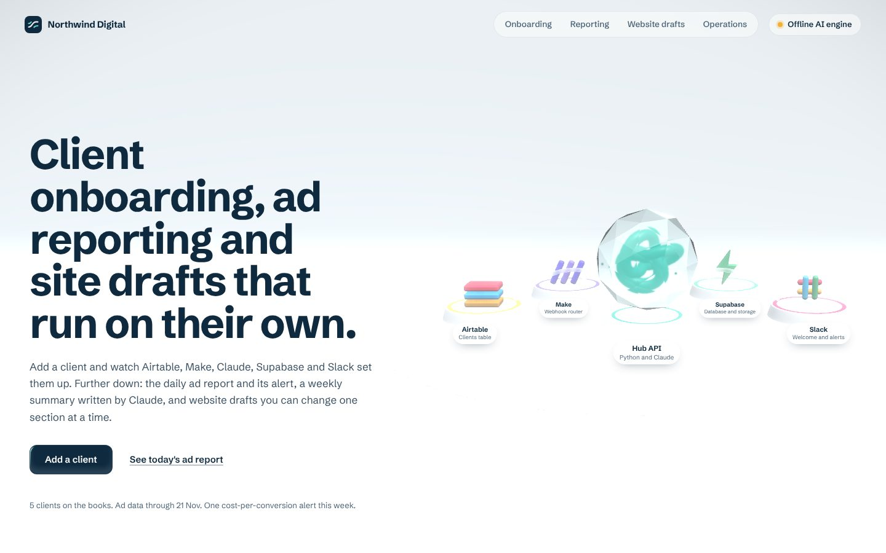
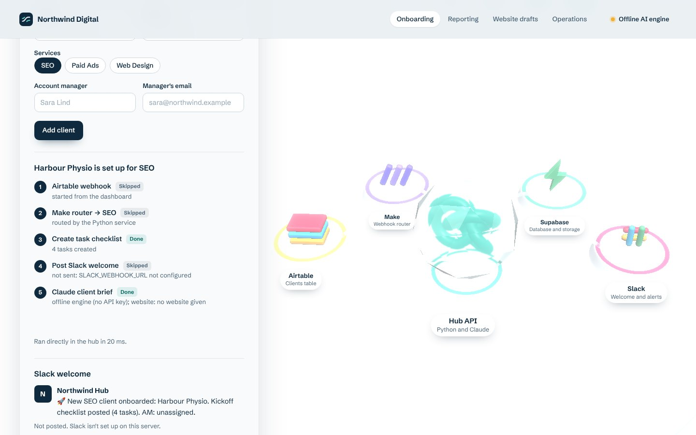
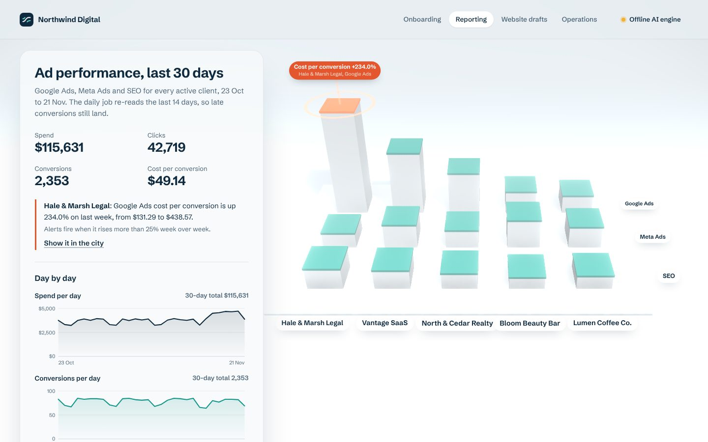
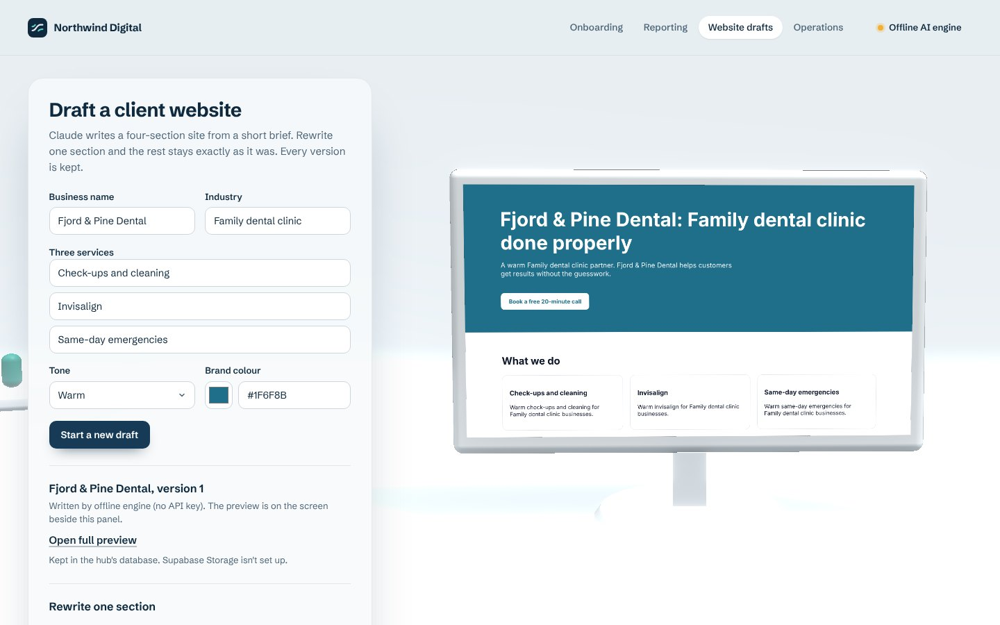
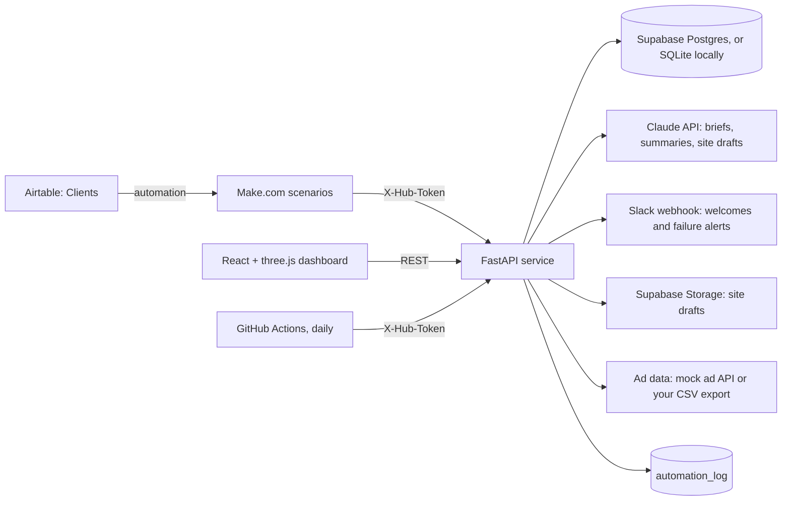

# Northwind Digital: Agency Automation Hub

Three automations for a fictional marketing agency, each running end to end:

- **A. Client onboarding.** A new client (from the form, or a new Airtable row through Make.com) gets a task checklist, a Slack welcome, a Claude-written client brief saved back to the database and Airtable, and an email draft for the account manager.
- **B. Campaign reporting.** A daily job pulls ad performance, upserts it without double counting, and feeds a dashboard with a 30-day trend, results by channel and client, and an alert when a client's cost per conversion rises more than 25% week on week. Claude writes a weekly summary. You can import real Google Ads or Meta exports.
- **C. Website drafts.** A short form produces a one-page site draft from Claude, shown live on a 3D monitor, stored in Supabase Storage and regenerated section by section.

Every automation logs success and failure to a table, and every failure sends a Slack alert.

| Onboarding | Reporting | Website drafts |
|---|---|---|
|  |  |  |

## What's real and what's sample data

- The five clients are fictional. Their Google Ads and Meta numbers are **priced from published 2026 benchmarks** for each client's industry: cost per click and cost per lead from [LocaliQ's 2026 search advertising benchmarks](https://localiq.com/blog/search-advertising-benchmarks/) and [LocaliQ's 2026 Facebook ads benchmarks](https://localiq.com/blog/facebook-advertising-benchmarks/) (leads campaigns). The dashboard lists the exact figures used. SEO rows are illustrative.
- One event is planted so the alert has something to find: Hale & Marsh Legal's Google Ads cost per conversion more than triples in the latest week.
- Clients you add get no simulated numbers. Import a real ad export (below) and they show your real figures.

## Architecture

- `backend/app`: FastAPI service. `onboarding.py`, `reporting.py` (daily job, dashboard maths, alerts), `importer.py` (Google Ads and Meta CSV), `sites.py`, `llm.py`, `checks.py` (data integrity checks), `jobs.py` (CLI).
- `backend/make`: the two Make.com scenario blueprints (JSON) and a script that fills in your API address and token.
- `backend/airtable`: table setup script and the two Airtable automation scripts.
- `backend/supabase/001_schema.sql`: the database schema, generated from the code.
- `frontend`: Vite, React, React Three Fiber, GSAP and Motion. One page, one 3D scene behind it.

## Run it locally

1. Install Python 3.12+ and Node 22+.
2. `cd demo-1-automation-hub/backend && pip install -r requirements-dev.txt`
3. `cd ../frontend && npm ci && npm run build`
4. `cd ../backend && uvicorn app.main:create_app --factory --port 8000`
5. Open http://localhost:8000. It starts on SQLite with the five sample clients, and every integration runs offline until you add its key.
6. Optional: copy `backend/.env.example`, fill in any keys (Claude, Supabase, Airtable, Slack) and export them before step 4.
7. Run the tests: `python -m pytest -q tests` (141 tests).

To deploy, use the Render Blueprint at the root of this repository (`render.yaml`). For Airtable and Make.com, follow [backend/airtable/README.md](backend/airtable/README.md).

## Use real ad data

- **In the dashboard:** Reporting, then *Import real ad data*. Google Ads and Meta exports work as they are (date, account or client, cost, clicks, conversions). Campaign lines are summed per day, and importing the same days again replaces them, so nothing is counted twice. Skipped lines are listed with the reason.
- **From the command line:** `python -m app.jobs daily --source csv --csv your-export.csv`, or `--source api --api-url ...` for an API that returns the same columns.

## Scheduled job

Render's free plan has no cron, so `.github/workflows/daily-report.yml` calls `POST /api/hooks/cron/daily-report` every morning. Add the repository secrets `HUB_URL` and `HUB_API_TOKEN` to turn it on.

## Business note

[How it would work for your agency](docs/business-note.md), one page for proposals.
