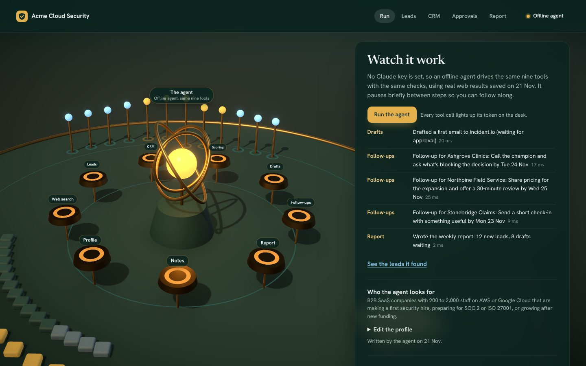
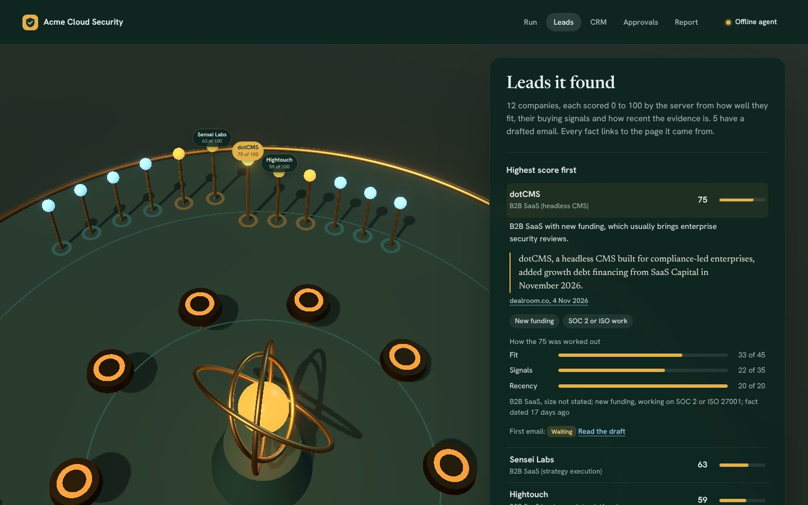
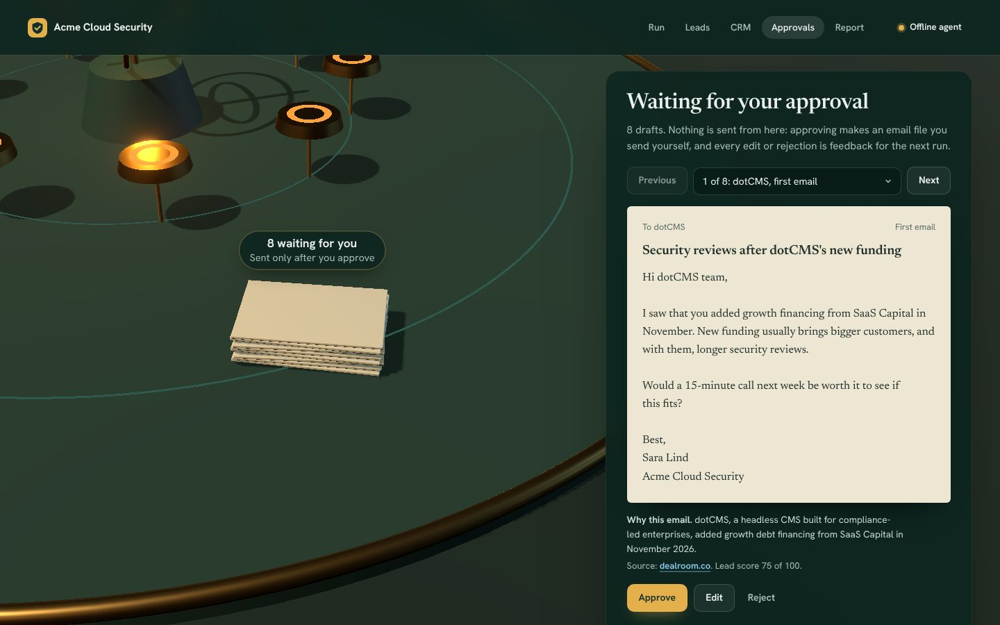
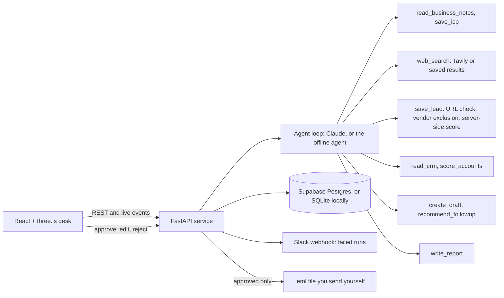

# Acme Cloud Security: B2B Sales Agent (proof of concept)

An agent that does a sales rep's research and first drafts, and sends nothing on its own:

1. **Learns the business.** Reads `product.md`, `competitors.md` and six won and lost deals, then writes an ideal customer profile. A rep can edit it; the rep's version wins.
2. **Finds leads.** Searches the web (Tavily) for companies showing buying signals: a first security hire, a SOC 2 or ISO 27001 audit, new funding.
3. **Scores them 0 to 100** on the server, with the reason shown: fit (up to 45), signals (up to 35) and how recent the evidence is (up to 20).
4. **Reads the whole CRM.** Flags deals stuck in Proposal or Negotiation for 30+ days, accounts untouched for 30+ days, and customers with an upsell signal.
5. **Drafts emails** for the top five leads, each citing one real fact with its source link, plus follow-ups for the most urgent CRM accounts.
6. **Waits for a person.** Every draft is approved, edited or rejected in the queue. Approving makes an email file to send yourself; nothing in the code can send.
7. **Learns from feedback.** Edits and rejection reasons go into the next run's context, and the page shows the before and after.
8. **Reports.** A one-page weekly report built from live data, ready to print.

| A run, step by step | Leads with sources | Approval queue |
|---|---|---|
|  |  |  |

## What's real and what's sample data

- **Leads are real companies** found in public web results, saved on 21 Nov 2026 for offline mode (`backend/app/data/research_snapshot.json`). Each fact was checked against its page, and the source link and date travel with the lead. Dates are shown only as precisely as the source gives them. With a Tavily key the agent searches the live web instead.
- **The CRM is fictional**: 50 invented companies (`scripts/build_crm.py`, fixed seed), with 8 stalled deals, 6 untouched accounts and 5 upsell signals. Import your own CSV export (below) to work on real accounts.
- **Engine:** with a Claude key, Claude runs the loop and chooses each tool. Without one, an offline agent drives the same nine tools through the same checks, so the guardrails are identical. The page always says which one ran.

## Architecture

Guardrails enforced in code, not in the prompt:

- A lead's URLs must come from a search made in the same run, so a source can't be invented.
- Other security vendors are excluded (they compete with Acme rather than buy from it), and each company is saved once.
- Drafts must cite their lead's fact and link; placeholders and email addresses are refused.
- There is no send tool. An `.eml` file is produced only after a recorded approval.
- Every run is logged with each tool call, its timing, and Claude's token counts. A failed run alerts Slack.

## Run it locally

1. Install Python 3.12+ and Node 22+.
2. `cd demo-2-sales-agent/backend && pip install -r requirements-dev.txt`
3. `cd ../frontend && npm ci && npm run build`
4. `cd ../backend && uvicorn app.main:create_app --factory --port 8000`
5. Open http://localhost:8000. On an empty database the offline agent runs once at start, so there are leads and drafts to review straight away.
6. Optional: copy `backend/.env.example`, add `ANTHROPIC_API_KEY` and `TAVILY_API_KEY` (and `DATABASE_URL`, `SLACK_WEBHOOK_URL`), export them and restart.
7. Run the tests: `python -m pytest -q tests` (24 tests, including a fake-Claude run that tries to invent a URL and skip steps).

To deploy, use the Render Blueprint at the root of this repository (`render.yaml`).

## Use your own CRM

CRM, then *Use your own CRM*. Export accounts from HubSpot, Salesforce or Pipedrive as CSV. It needs company, stage and last contact columns; deal value, owner, size, industry and notes are read when present. Rows it can't use are listed with the reason. The next run works on your accounts.

## Business note

[How it would work for your sales team](docs/business-note.md), one page for proposals.
