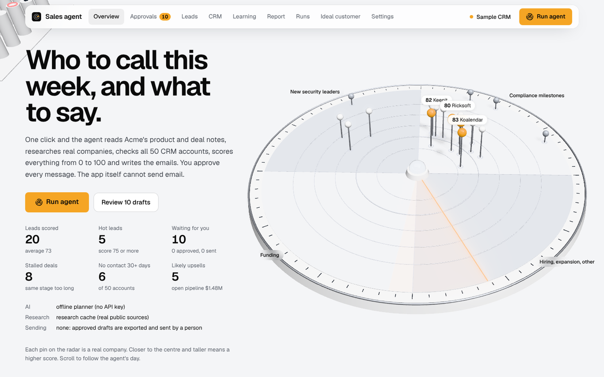
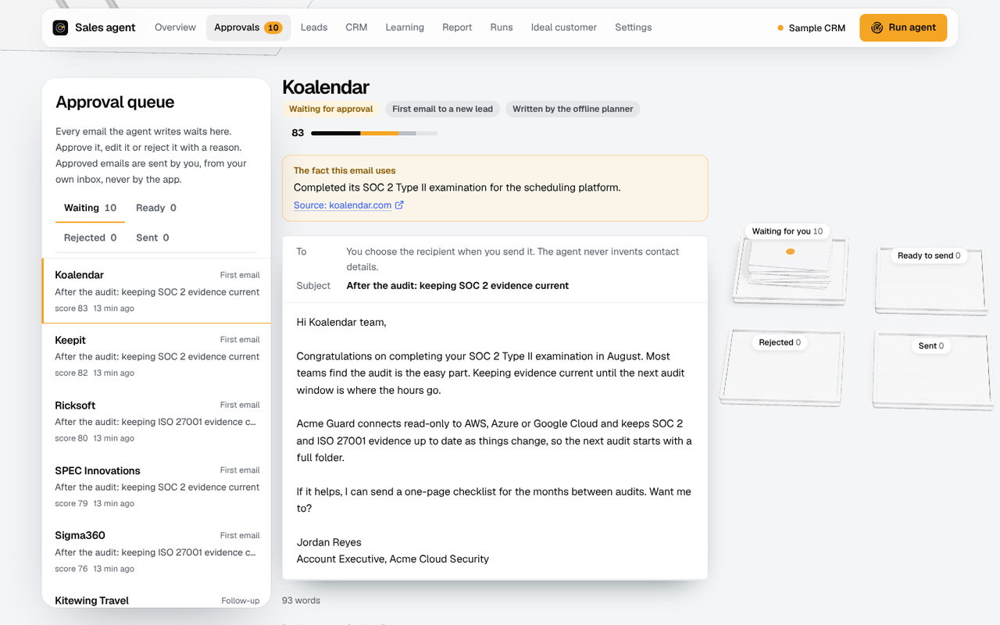
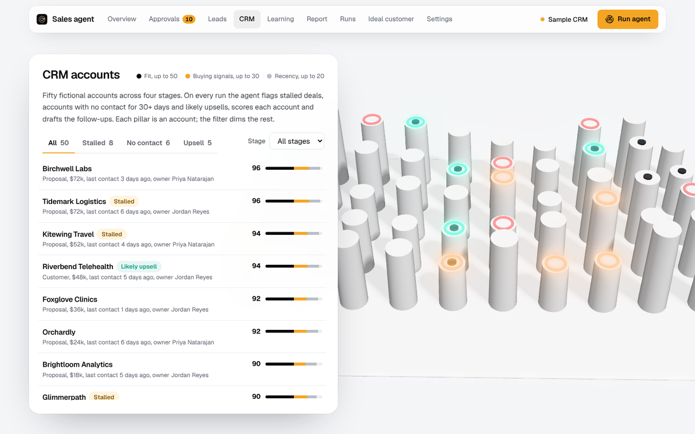
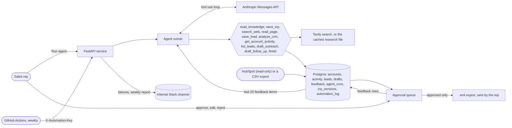

# Demo 2: B2B Sales Agent

An AI sales agent, shown for a fictional seller, **Acme Cloud Security**. One click and it reads
the product and deal notes, writes an ideal customer profile, researches real companies on the
web, analyses the CRM, scores everything from 0 to 100 with a plain-English reason, drafts
personalised first emails and follow-ups, and prepares a one-page weekly report.

A person approves every message. The agent has no tool that can send anything, and the app has no
email client at all: approved drafts are exported and sent by the rep from their own inbox.

**Live:** https://sales-agent-production-68fda07e.up.railway.app  
A one-page summary for clients is in [docs/one-pager.md](docs/one-pager.md).

## What it does

| Step | What happens | Where to see it |
| --- | --- | --- |
| 1. Learn the business | Reads `product.md`, `competitors.md` and 3 won + 3 lost deal notes, then saves an ideal customer profile (ICP). The rep can edit it; their version always wins. | Ideal customer |
| 2. Generate leads | Searches the web (Tavily) for real companies with a buying signal: SOC 2 or ISO 27001 milestones, a new CISO, security hiring, funding. Each lead is saved with its source URL and a one-line reason. | Leads |
| 3. Analyse the CRM | Flags the 8 stalled deals, the 6 accounts with no contact for 30+ days and the likely upsells. | CRM accounts |
| 4. Prioritise | Scores every lead and account 0 to 100: fit (up to 50) + buying signals (30) + recency (20), each with a plain-English reason. | Every list |
| 5. Draft outreach | Writes a first email for the top 5 leads, using one real fact from research and citing its source link. | Approval queue |
| 6. Recommend follow-ups | For accounts already in conversation: the next step, a send date (a weekday) and a draft. | Approval queue |
| 7. Report | One-page weekly summary from live data: new leads, top priorities, stalled deals, drafts waiting. Print, PDF, Markdown or Slack. | Weekly report |

Then the human part: **Approve**, **Edit** or **Reject** (with a one-line reason). Edits and reasons
go into the `feedback` table, the next run gets the last 20 of them in its prompt, and the change
shows up as a before and after draft.

## Sample CRM or your CRM

The app starts on a **sample CRM** (50 fictional accounts) and switches to yours from Settings.

* **Import a CRM export**: a CSV from HubSpot, Salesforce, Pipedrive or a sheet. Common column
  names are recognised (company, domain, stage, amount, owner, last contacted, date entered
  current stage, contact). Stages are mapped to Prospect, Discovery, Proposal and Customer;
  closed-lost rows are skipped, and importing again updates accounts instead of doubling them.
* **HubSpot**: paste a private app token with read scopes only. The app reads companies, deals,
  contacts and owners, maps each pipeline stage by its win probability (under 25% Prospect, under
  50% Discovery, otherwise Proposal; closed won is Customer) and takes the date each deal entered
  its stage from the deal's history. It syncs every hour and never writes to HubSpot.
* **Your company notes**: in real mode the agent reads your product, competitor and deal notes
  from Settings instead of Acme's. A run is refused, with a list of what is missing, until the
  product notes, a Claude API key and a Tavily key are in, so it never researches for the wrong
  company.

Once your CRM is loaded the whole app locks behind an access code (`OWNER_TOKEN`, plus an optional
read-only `VIEWER_TOKEN`), because pipeline data is private. Keys pasted in Settings are
encrypted with Fernet (key derived from `APP_SECRET`), shown masked, and can only be changed
with the owner code. **Show the demo again** wipes your data and reloads the sample.

## Architecture

* **Agent loop** (`backend/app/agent/runner.py`): the model calls the tools in a loop with prompt
  caching; network tools run in parallel, database writes stay sequential. A 150 second budget
  and a completion check guarantee the run delivers its targets inside 3 minutes, even if the
  model runs long or the API fails.
* **Offline mode**: without `ANTHROPIC_API_KEY` a deterministic planner calls the very same tools
  with template drafts, so the whole demo works with no keys. Without `TAVILY_API_KEY` research
  runs over `backend/data/research_snapshot.json`: 30 real companies with real public sources
  (press releases and news), gathered for this demo.
* **Scores are computed in code** from the ICP (`backend/app/agent/scoring.py`), never guessed by the
  model, so they are consistent and every point is explained.
* **Guardrails** (`backend/app/agent/tools.py`, `guardrails.py`): a fact can only cite a URL that
  search returned in that run; demo domains and existing CRM accounts are refused; first emails
  greet the team and may not contain names, email addresses, phone numbers or placeholders;
  every draft must mention the fact it cites; learned rules (length, no meeting ask, skip large
  companies) are enforced. A failed check goes back to the model as a tool error it can fix.
* **The safety rule is structural**: there is no send tool, no SMTP client, and
  `/api/drafts/{id}/eml` and `/mark-sent` refuse any draft without an approve or edit row in the
  `feedback` table. `tests/test_safety.py` checks all three, and also that the only outbound
  POST requests are the internal Slack webhook, research, key tests and HubSpot's read-only
  batch reads.
* **Dashboard**: React 19, Vite, Tailwind and React Three Fiber. One 3D scene sits behind every
  page (the lead radar, the agent's stations, the approval trays, the CRM pillars) and the camera
  flies to the part each section talks about. Each route has its own title, description and
  JSON-LD for search engines.

## Set up (local, about 5 minutes)

1. `git clone https://github.com/umer-78/ai-automation-demos && cd ai-automation-demos/demo-2-sales-agent`
2. `python3.11 -m venv .venv && source .venv/bin/activate && pip install -r backend/requirements-dev.txt`
3. `cd frontend && npm ci && npm run build && cd ..` (builds the dashboard into `backend/app/static`)
4. `cp .env.example .env` and, optionally, add `ANTHROPIC_API_KEY` and `TAVILY_API_KEY`
5. `cd backend && uvicorn app.main:app --reload`, then open http://localhost:8000 and click **Run agent**
6. `python -m pytest -q` runs the 49 tests (acceptance criteria, safety, learning loop, live loop with a scripted model, CRM import and HubSpot sync)

For dashboard development run `npm run dev` in `frontend/` (port 5174, proxies `/api` to port 8001
by default; set `VITE_DEV_API=http://localhost:8000` to point it elsewhere).

## Deploy (Railway, about 10 minutes)

1. New project, **Deploy from GitHub repo**, pick this repo. Set the service's root directory to
   `demo-2-sales-agent`; Railway finds the Dockerfile.
2. Add a **Postgres** database and set `DATABASE_URL=${{Postgres.DATABASE_URL}}` on the service.
   The tables are created on first start (`supabase/schema.sql` has the same schema for Supabase).
3. Set `ENVIRONMENT=production`, `PUBLIC_BASE_URL` (the service URL), and long random values for
   `OWNER_TOKEN`, `APP_SECRET`, `AUTOMATION_API_KEY` and `ADMIN_TOKEN`.
4. Generate a domain, open **Settings**, enter the owner code and paste the Claude, Tavily,
   HubSpot and Slack keys you want. Each one has a **Test connection** button.
5. Optional: add repository secrets `ACME_URL` and `ACME_AUTOMATION_KEY`;
   `.github/workflows/acme-weekly.yml` runs the agent every Monday and posts the report to Slack.

`render.yaml` at the repo root does the same on Render (free plan, Supabase for the database).

Public demo guards: 6 agent runs per visitor per hour, at most 40 paid AI runs a day (extra runs
use the offline planner), and `POST /api/admin/reset` with `X-Admin-Token` reloads the CRM.

## Acceptance criteria

| Criterion | How it is met | Test |
| --- | --- | --- |
| One click gives at least 10 scored leads and 5 drafts in under 3 minutes | Offline runs take well under a second; live runs have a 150 s budget plus a fallback that fills any gap | `test_one_click_gives_10_scored_leads_and_5_drafts_fast`, `test_live_run_survives_an_api_outage` |
| Each score shows a reason; each draft cites its fact with a source link | Scores built in code with a sentence per part; drafts store `cited_fact` and `source_url` from the lead's own facts | `test_every_score_has_a_reason_and_every_draft_cites_a_sourced_fact` |
| No code path can send without a recorded approval | No send tool, no email client, export and mark-sent check the `feedback` table, not just a status column | `test_no_path_sends_without_a_recorded_approval`, `test_safety.py` |
| A rejected draft's reason appears in the next run's context | `agent_runs.context_feedback` stores exactly what the model was given | `test_rejected_reason_reaches_the_next_run` |
| Every agent run is logged with the tools it called | `agent_runs.tools_called`: tool, input, result, timing, who called it (AI, planner or fallback) | `test_every_run_is_logged_with_its_tool_calls` |
| The weekly report renders from live data | Built on request from the database | `test_weekly_report_renders_from_live_data` |
| Shared rule: failures are logged and alerted | `automation_log` + Slack alert, with a "Test a failure alert" button | `test_failures_are_logged_and_alerted` |
| Your CRM is read correctly and never written to | Stage mapping by pipeline probability, dates from deal history, read-only calls | `test_hubspot_sync_reads_stages_dates_and_owners`, `test_csv_import_replaces_the_sample_crm`, `test_only_the_internal_slack_webhook_is_called` |
| Real pipeline data is never public | Access code on every route once your CRM is in | `test_real_crm_needs_an_access_code` |
| The agent never sells for the wrong company | Runs are refused until your notes and keys are in | `test_agent_needs_your_product_notes_in_real_mode` |

The suite also runs against Postgres (`TEST_DATABASE_URL=postgresql://... pytest`), which is what CI does.

## Data

* **Mock CRM**: `backend/data/crm_accounts.csv` and `crm_activity.csv` (50 fictional accounts,
  185 activities, 4 stages: 14 Prospect, 13 Discovery, 11 Proposal, 12 Customer). Dates are stored
  as "days ago", so the 8 stalled deals and 6 untouched accounts stay that way whenever you deploy.
  Regenerate with `python -m scripts.generate_crm`. Domains end in `.example`, so nothing can reach a real inbox.
* **Research cache**: `backend/data/research_snapshot.json`, 30 real companies with dated facts
  and source URLs. Profile fields the sources did not state are marked `unknown`, never guessed.
  No people's names are stored and drafts never address a named person.
* **Notes the agent reads**: `backend/app/knowledge/` (product, competitors, deal notes).

## Answers to the brief's open questions

* **Web search API**: Tavily. The free plan has 1,000 credits a month and a basic search costs 1
  credit; a run uses 3 to 6 searches. The cached research file keeps the demo working without a key.
* **Lovable or Replit**: neither was needed. The dashboard is React + Vite, built into the FastAPI
  service, so there is one deploy and one URL. It is plain React and Tailwind, so it can be
  moved into Lovable later if a client prefers.
* **Make.com blueprints**: in the repo as JSON for Demo 1 (`demo-1-automation-hub/make/`).

## API

Interactive docs at `/docs`. Main routes: `POST /api/agent/run`, `GET /api/runs/{id}`,
`GET /api/agent/context` (the exact prompt the next run will get), `GET /api/leads`,
`GET /api/accounts`, `GET /api/drafts`, `POST /api/drafts/{id}/approve|edit|reject|mark-sent`,
`GET /api/drafts/{id}/eml`, `GET|PUT /api/icp`, `POST /api/icp/preview`, `GET /api/learning`,
`GET /api/report/weekly(.md)`, `GET /api/data/status`, `POST /api/data/import`,
`POST /api/data/hubspot/sync`, `GET /api/data/notes`, `PUT /api/data/notes/{name}`, `GET|PUT|DELETE /api/settings/{provider}`.

Built by [Umer Hashmi](https://github.com/umer-78). MIT licence.
